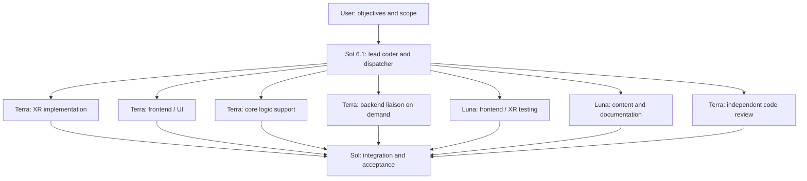

# Multi-agent framework for ASTRA P1

Sol 6.1 leads coding and dispatch. Terra executes bounded implementation and review tasks; Luna handles content, test preparation, and routine checks. Our project role is **P1 — XR & Interaction Developer**, including the shared XR rig, input, interactables, all UI, Hub, L0 Safety & Calibration and L1 Cadet Orientation. P1 identifies a teammate role here; it is distinct from the PRD's P1 feature priority. L0/L1 are curriculum levels, not levels in the agent hierarchy.

Read the [P1 codebase analysis](p1-codebase-analysis.md) for the actual source inventory and stage readiness. Deliver shared interactables, rig and logger first (S1.1–S1.6, end of week 1), then UI/pause/Hub (remainder of S1, end of week 2). S2 supports the Core owner's L4 slice through fixes to our prefabs. L0/L1 scene delivery follows in S3. Backend and shared Core specialists are dependency liaisons rather than parallel owners of those systems.

This is a repository working agreement and task plan. `framework.json` describes assignments and dispatch rules; it is not an executable scheduler, API integration, or installed model configuration. A coding host applies these rules through its agent tools. The current session's model is controlled by the host; assigning `gpt-6.1-sol` here does not switch it. There is no Opus dependency.

## Structure



This diagram lists roles, not simultaneous workers. Run at most three helpers alongside Sol. Reuse workers between tasks and reserve capacity for review when implementation is ready.

| Role | Model | Delegation boundary |
|---|---|---|
| Lead and dispatcher | Sol 6.1 | Research, architecture, design of important logic, scope, task sequencing, review decisions, integration. |
| XR engineer | Terra | One input adapter, interactable, prefab, or rig change at a time within `XR/`. |
| Frontend engineer | Terra | One UI component/prefab or Hub presentation task within `UI/` and the owned Hub scene. |
| Core logic specialist | Terra | Analyze runner/scorer/progress contracts; implement only small, explicitly assigned level-local helpers. Shared Core and App remain read-only. |
| Backend specialist | Terra | Activate only for a concrete coach/offline dependency. Inspect existing interfaces and prepare a handoff to its owner; backend implementation remains outside our scope. |
| Frontend/XR tester | Luna | Prepare or execute bounded checks, reproduce failures, capture evidence. Test code requires an exact approved file list and compatible test assembly. Escalate difficult test logic to Sol/Terra. |
| Content helper | Luna | One mission draft or wording pass against Sol-approved event/target IDs. |
| Code reviewer | Terra | Read-only review by a worker that did not author the change. Report findings with severity, location, and a reproduction or rationale. |

`potentialWritePaths` in the configuration are ceilings, not permission to edit every matching file. Each dispatch must narrow them to exact paths. Sol writes consequential logic; helpers handle bounded supporting changes. Sol's technical leadership does not take over the human Integration Lead's project ownership.

## Dispatch protocol

1. Sol reads the current contract, stage, git revision/status, and dependencies. It states the design and defines a small task with observable acceptance criteria.
2. Sol marks a task `ready` only when prerequisites are satisfied. For implementation, the relevant P1 stage must also be authorized. Missing Unity/package/template dependencies block scene work; they do not block a read-only analysis or draft.
3. Sol records each worker's exact file list before starting it. Keep this active assignment list in the lead's working context or an explicitly assigned file under `.agents/evidence/`. Treat an asset and its `.meta` as one lock. Treat shared asmdefs as exclusive files. Split or serialize overlapping tasks before launch.
4. Launch up to three independent helpers. Supply focused context and read-only dependencies; do not make every worker reread unrelated source. Helpers cannot dispatch other workers or change their own scope.
5. A helper stops if it needs an unassigned path, contract change, unavailable model/tool, or has failed twice to fix a bug. It reports a minimal reproduction and continues only independent authorized work.
6. The helper returns a diff summary and actual check results. `review` means ready for review, not complete. A read-only independent Terra reviewer checks substantive changes and ownership, then Sol reviews findings and integrates serially.
7. Sol alone marks a task `accepted`, after its acceptance evidence exists. If a requested model is unavailable, explicitly reassign or defer; do not silently substitute. Release file locks after review/acceptance or a documented handoff of partial work.
8. At a P1 stage boundary, produce its required stage report. User authorization for this framework/task plan does not start implementation stages or authorize commits, pushes, merges, or publication.

Task lifecycle: `planned → ready → running → review → accepted`. Review can return `changes_requested → ready`. Any unfinished state can become `blocked`; return it to `ready` only when prerequisites are satisfied. Include enough detail in a blocked result to resume from the current diff.

## Task packet

Use this packet through the coding host's helper-agent tool. The example is a future S1 task, not work authorized or executed by this design delivery.

```json
{
  "taskId": "XR-01",
  "stage": "S1",
  "role": "xr_engineer",
  "objective": "Add InputModalityTag using the lead-approved interactor lookup design.",
  "contractVersion": "1.2",
  "baseRevision": "<git revision plus existing dirty-file list>",
  "dependsOn": ["SETUP-01", "DESIGN-01"],
  "writeFiles": [
    "Assets/ASTRA/XR/Input/InputModalityTag.cs",
    "Assets/ASTRA/XR/Input/InputModalityTag.cs.meta"
  ],
  "readOnlyDependencies": [
    "CONTRACT.md",
    "Assets/ASTRA/Core/Assessment/Contract.cs",
    "Assets/ASTRA/XR/Input/ISemanticInputSource.cs"
  ],
  "interfaceConstraints": [
    "Use InputModality constants.",
    "Do not change shared Core or asmdefs.",
    "Do not emit or score mission events from the tag."
  ],
  "acceptanceCriteria": [
    "Actual acting interactor supplies its modality; simulator reports simulator.",
    "Invalid serialized modality produces an actionable validation error."
  ],
  "checks": ["Unity compilation with the pinned project", "Targeted interactor/modality verification"],
  "stopConditions": ["Required interface change", "Unassigned file needed", "Two failed fix attempts"]
}
```

Each result must include:

```json
{
  "taskId": "XR-01",
  "status": "review",
  "changedFiles": ["<exact paths>"],
  "checksRun": ["<command or manual steps, environment, exit code/outcome>"],
  "results": ["<observed behavior; attach concise evidence>"],
  "untested": ["<unavailable Editor, simulator, or headset checks>"],
  "blockers": [],
  "nextAction": "Independent review, then Sol acceptance."
}
```

Do not expose keys or personal/session data in task context or evidence. Evidence should identify task, revision/build, environment, input route, expected/actual behavior, and relevant sanitized output. Store only small reports under `.agents/evidence/`; learner logs stay local as required by the contract.

## Concurrent work and verification

An implementation wave can contain an XR engineer editing one interactable, a frontend engineer editing one UI component, and a Luna helper drafting wording. Their files must be disjoint and their interfaces already agreed. When one task finishes, assign the free slot to independent review or testing. A blocked worker does not occupy a slot indefinitely.

Run `python3 scripts/validate_content.py` for mission/content changes. Use the pinned Unity Test Runner for changed C# behavior when the project exists. Tests that need scenes/packages must wait for them; report `not run` with the missing dependency. Do not install or upgrade project packages to make a task pass.

Review checks event uniqueness, subscription cleanup, actual input modality, pause/recenter behavior, contract signatures, assembly direction, and existing-work preservation. Test transitions and failure cases instead of duplicating implementation. Unity imports and all asset metadata must be verified in the real project.

Editor, simulator, and headset evidence are separate. Only headset checks establish seated reach, comfort, hit reliability, text readability, tracking, and final L0/L1 acceptance. A validator pass proves neither target uniqueness in a scene nor a playable level.

The [L0/L1 task plan](l0-l1-plan.md) contains prerequisites, execution waves, and the acceptance matrix. Existing source documents remain authoritative for the product; this framework supplements their collaboration process.
