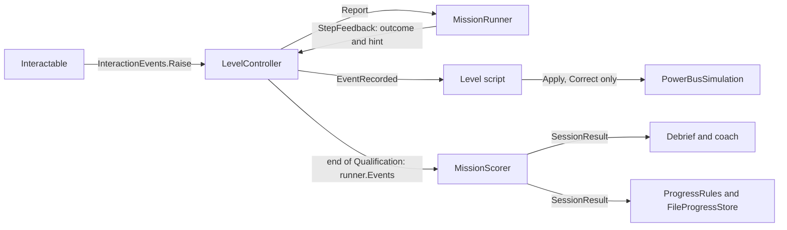
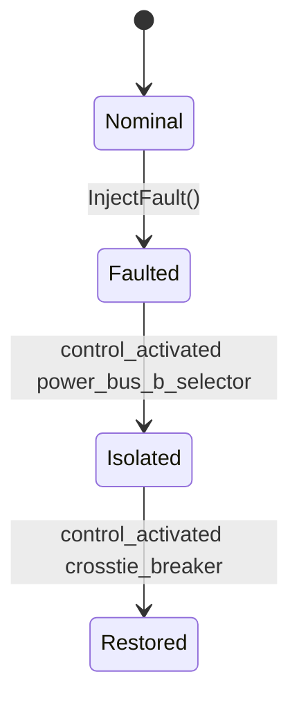

# Core: how the logic works

`Assets/ASTRA/Core` holds the logic behind ASTRA Academy. It decides whether each cadet action was right, scores each attempt, runs the fictional power fault, and saves progress.

It's plain C# with **no Unity code** (`noEngineReferences: true`). It uses no clock, no randomness and no global state, so the same input always gives the same output (NFR-QUAL-01). AI coach output never reaches it (FR-AI-04, FR-SIM-04). The exact shapes are in [`CONTRACT.md`](../../../CONTRACT.md) §1–§6; this page explains how the code behaves.

| File | What it does |
|---|---|
| `Assessment/EventValidator.cs` | Checks that an event uses contract values. Shared by the runner and the scorer. |
| `Mission/StepMatcher.cs` | **The step-matching rule.** The only copy of it; the runner and scorer both call it. |
| `Mission/MissionRunner.cs` | Live tracking during one attempt: was this action right, and what's the hint? |
| `Assessment/MissionScorer.cs` | Turns a finished attempt's events into a `SessionResult` (pass or retry, and what went wrong). |
| `Assessment/InMemoryEventLog.cs` | A simple append-only list of events. |
| `Simulation/PowerBusSimulation.cs` | The power fault: Faulted → Isolated → Restored. |
| `Simulation/PowerPanelModel.cs` | What the L4/L7 power panel shows (state, STATUS text, caution alarm) through a whole module. |
| `Progress/ProgressRules.cs` | What a scored attempt changes: attempts, pass, best time, next level unlocked. |
| `Progress/FileProgressStore.cs` | Saves and loads `progress.json` so that a crash or a broken file never loses progress. |

## The big picture



1. During **Practice** and **Qualification**, every action the cadet takes goes to a fresh `MissionRunner`. It answers at once: correct, incorrect, out of order, or ignored, plus the hint for the step still pending. Practice shows that hint; Qualification does not.
2. When **Qualification** ends, its events go to `MissionScorer`, which computes the result from scratch.
3. The result goes to the debrief and the coach, then to `ProgressRules`, and finally `FileProgressStore` saves it.

## 1. Event checks (`EventValidator`)

An event is valid when:
- `event`, `input` and `result` are contract values (the constants in `Contract.cs`);
- `targetId` and `sessionId` are not empty;
- `missionId` is the mission being played;
- `timestampMs` is at least 0 and never earlier than the event before it. Equal times are allowed.

Anything else throws an `ArgumentException` whose message names the field and the bad value, for example `trace[4]: event 'teleport' is not a contract event`. If the runner rejects a report, **nothing changes**: no event is logged and the current step stays put.

## 2. The step-matching rule (`StepMatcher`)

The mission's steps are sorted by `order`. A **pointer** marks the first step not done yet. Every event is matched against the steps like this:

| What the event matches | Outcome | Logged `result` | Effect |
|---|---|---|---|
| The step at the pointer | **Correct** | `correct` | Step done; pointer moves on |
| A later step, with only *optional* steps before it | **Correct** | `correct` | The optional steps in between are **skipped**; that step is done |
| A later step, with a *critical* step before it | **OutOfOrder** | `incorrect` | Sequence error recorded; pointer does **not** move |
| Nothing ahead, but a step behind the pointer (a repeat) | **Ignored** | `neutral` | Nothing |
| Nothing, and it's looking, grabbing, releasing, pausing, resuming or recentering | **Ignored** | `neutral` | Nothing (these are never wrong by themselves) |
| Nothing, and it's any other action | **Incorrect** | `incorrect` | `targetId` recorded as a wrong action |

A step matches when both its `expectedEvent` and its `targetId` are the same as the event's. The mission validator makes sure no two steps share that pair, so at most one step can ever match.

Each event is checked once against the step list, which is fast for any realistic mission.

## 3. Mission runner (live, one per attempt)

```csharp
var runner = new MissionRunner(mission, sessionId);          // fresh runner + new sessionId per attempt
StepFeedback fb = runner.Report(eventName, targetId, input, timestampMs);
// fb.Outcome: Correct | Incorrect | OutOfOrder | Ignored
// fb.StepId:  the step it matched (Correct / OutOfOrder), else null
// fb.Hint:    hint of the step still pending AFTER this event (null when finished)
runner.CurrentStep;  // next step to do, null when finished
runner.IsComplete;   // true once the last step is done (optional steps before it may have been skipped)
runner.Events;       // read-only log, each event with its result stamped
```

The constructor throws an `ArgumentException` if the mission is null, has no steps, has a null step, or has two steps with the same `order`, or if `sessionId` is empty. The runner never reads the time itself: the caller passes `timestampMs`, measured from the start of the attempt with paused time left out.

## 4. Scorer (the final result)

`MissionScorer.Score(mission, sessionId, trace)`:
1. **Checks every event first.** It throws on the first bad one and doesn't score at all.
2. **Replays the trace through the same `StepMatcher`.** It never trusts the stored `result` values.
3. **Fills in the result** (each list in the order shown):
   - `completedSteps`: stepIds in the order they were done
   - `skippedSteps`: optional steps jumped over during the attempt, then optional steps never reached
   - `omittedCriticalSteps`: critical steps never done
   - `sequenceErrors`: one stepId per OutOfOrder event
   - `incorrectActions`: one targetId per Incorrect event
   - `completionTimeMs`: the last event's time, or 0 if there were no events
4. **Pass = no critical step was missed.** Speed and mistakes never fail an attempt on their own; they appear in the debrief.

The runner and scorer share one rule, so the feedback during the attempt and the final score always agree. The tests check this on every fixture.

**Worked examples** (the L7 mission, `l7-restore-power-v1`; its only optional steps are `locate_panel` and `open_checklist`):

| Case | What the cadet does | Result |
|---|---|---|
| Demo fixture (`session-events.ok.json`) | Selects Bus A, then fixes it with Bus B | **Pass**; `incorrectActions: [power_bus_a]` |
| `skip_optional_steps` | All 6 critical steps in order; never looks at the panel or checklist | **Pass**; both optional steps skipped |
| `out_of_order_then_fixed` | Closes the cross-tie before isolating Bus B, then does it properly | **Pass**; `sequenceErrors: [crosstie]` |
| `critical_step_omitted` | Presses Report without closing the cross-tie | **Fail**; `crosstie` and `verify_recovery` omitted |
| `repeats_neutral_and_wrong` | Calibrates twice, pauses, grabs a tool, flips the wrong switch, stops | **Fail**; 5 critical steps omitted, `incorrectActions: [lights_switch]` |

## 5. Power-bus simulation (`PowerBusSimulation`)



- Any other event changes nothing. `Apply` returns `true` only when the state changed, and `StateChanged` fires once per real change.
- `InjectFault()` makes the bus Faulted **from any state**, so each attempt starts with a fresh fault. `Reset()` returns it to Nominal from any state.
- **The level script applies only events the runner judged Correct.** That way a breaker pressed out of order never restores power, even if the simulation itself would allow it. `PowerPanelModel` (below) does this for L4 and L7.

The default control ids are L7's. A level with other ids uses `new PowerBusSimulation(isolateTargetId, crossTieTargetId)`. L4, for example, uses `power_bus_b_dial` and `crosstie_lever`.

### The power panel (`PowerPanelModel` + `PowerPanelView`)

`PowerPanelModel` wraps the simulation and decides everything the panel shows. Being plain C#, it is tested like the rest of Core:

| Moment | Panel |
|---|---|
| Practice or Qualification starts | A fresh fault: STATUS `FAULT`, caution alarm **on** |
| Correct ACK on `caution_ack_button` | Alarm **off**; the fault is still there (acknowledging is not fixing) |
| Correct isolate, then correct cross-tie | STATUS `ISOLATED`, then `RESTORED` |
| Wrong, out-of-order or ignored action | Nothing changes |
| Briefing or Demonstration (including a restart) | Back to `NOMINAL`, alarm off |
| Debrief | Nothing changes, so the cadet sees how they left the panel |

`Assets/ASTRA/Levels/L4_Emergency/PowerPanelView.cs` is the thin Unity side, used by both L4 and L7. It forwards the LevelController's `PhaseChanged` and `EventRecorded` to the model, then draws the result:
- it shows the GameObjects listed for the current state (lights and labels);
- it sends the STATUS text through a `UnityEvent<string>`, which can be wired to any text component;
- it calls `AlarmIndicator.SetAlarm` with the caption `CAUTION — POWER: BUS B FAULT`.

The control ids are set in the Inspector. The view never calls the runner (CONTRACT.md §8.6). `LevelAttemptReset.cs` in the same folder resets the panel's controls at the start of each attempt. The L4 and L7 folders each have a README with the full scene-build spec.

## 6. Progress (`ProgressRules`, `FileProgressStore`)

**Rules.** `ProgressRules.RecordAttempt(state, level, missionId, result, availableLevels)` changes `state` in place:
- `attempts` goes up by 1;
- on a pass, the level is marked passed, `bestTimeMs` keeps the lowest passing time, and the **next level in `availableLevels`** is unlocked. `availableLevels` means the levels whose scene is in Build Settings, so a level that isn't built yet is jumped over. For example, with levels {0, 1, 3, 4, 7}, passing L1 unlocks L3;
- a failed attempt never takes away a pass or a best time already earned;
- `unlockedLevels` stays sorted with no duplicates, and level 0 is always unlocked.

**Saving.** `new FileProgressStore(Application.persistentDataPath, JsonUtility.ToJson, JsonUtility.FromJson<ProgressState>)`. The JSON functions are passed in, so Core never touches Unity.

`Save` makes three moves, and each crash point leaves something `Load` can handle:

| Save step | If the app dies here, the files are… | `Load` returns |
|---|---|---|
| 1. Write `progress.json.tmp` and flush it to disk | The old `progress.json` + a half-written tmp | The old save |
| 2. Delete `progress.json` | The old `progress.json` + a complete tmp | The old save (that one attempt is lost; nothing is corrupted) |
| 3. Move the tmp file to `progress.json` | Only the complete tmp | **The new save, recovered from the tmp** |

`Load` **never throws**:
- **Nothing saved:** a fresh state (only L0 unlocked).
- **Unreadable `progress.json`:** renamed to `progress.json.bak` (so it can be inspected), and a fresh state is returned.
- **Read error:** a fresh state is returned.
- **`LastLoadWarning`** explains why, whenever the load wasn't normal, so the caller can log it.

`Save` *can* throw an `IOException`, for example when the disk is full. The caller should catch it, log it and tell the cadet.

## 7. Tests

The tests are in `Assets/ASTRA/Tests/EditMode/`: 224 of them, built on the contract fixtures, the L4/L7 missions and seeded random attempts. They cover:
- every fixture and all 4 scoring cases;
- the runner and scorer agreeing on every case;
- determinism (same input, same result);
- every kind of invalid input;
- every simulation transition and non-transition, including "only Correct events change the power";
- the unlock and best-time rules;
- the file store across every crash point and every kind of corrupt file;
- the L4 mission played end to end, plus the style guide's countable limits on L4 and L7;
- **rules that must always hold** (`InvariantTests`), checked on 500 random attempts per mission (seed 1234) for L7, L4 and three synthetic missions:
  - every step ends up exactly once in completed, skipped or omitted;
  - only critical steps are omitted;
  - pass means nothing critical was missed;
  - steps complete in mission order;
  - the runner and scorer agree;
  - scoring a prefix never contradicts the full attempt;
  - the stored `result` field is ignored;
- **edge cases** (`EdgeCaseTests`): single-step and all-optional-but-one missions, gaps in `order`, actions after completion, attempts of only neutral actions, equal timestamps, times beyond `int.MaxValue`, and odd target ids (kept as data).

A bug was deliberately planted in each part to confirm the tests catch it.

**C# vs the Python reference.** On 2026-11-14, 4,000 random attempts on L7 and L4 (1,247 passing, 2,753 failing) were scored by this C# code and by `scripts/validate_content.py`. They gave the same result, and the same per-event `result`, on all 4,000, with 0 mismatches.

### Determinism and performance review (S4.1, S4.2)
- **Pure:** Core uses no clock, randomness, static mutable state, `UnityEngine` or I/O. The one exception is `FileProgressStore`, which only reads and writes `progress.json`.
- **Exceptions mean bad input only.** Normal play, including wrong, repeated or out-of-order actions, never throws.
- **Allocation:** `MissionRunner.Report` makes two small objects per action, the logged `SessionEvent` and the returned `StepFeedback`, both needed. It uses no LINQ. Error-message strings are built only when input is invalid. The scorer allocates only a sorted copy of the step list and its result lists.
- **Speed:** scoring a 500-action attempt takes a median of **0.13 ms** in Unity 6000.3.28f1 on the development laptop (0.1 ms in the .NET harness, median of 21 runs). Running the same 500 actions live takes about 0.18 ms. The budget is 5 ms on the headset; that number still has to be measured on the device.

### Running the tests
- **In Unity:** Window → General → Test Runner → EditMode → Run All. From a terminal: `"<Unity editor>" -batchmode -projectPath . -runTests -testPlatform EditMode -testResults editmode-results.xml`
- **Outside Unity:** any .NET test project that compiles these files with NUnit 3 can run them. Set the environment variable `ASTRA_REPO_ROOT` to the repo root; `TestJson` and `FixtureLoader` switch to `System.Text.Json` automatically.
- **Status (2026-11-14):** all 224 tests pass in **Unity 6000.3.28f1** (batch mode, no compiler warnings) and in a .NET 10 harness. Nothing has run on a headset yet.

## 8. Changing a rule

The step-matching and scoring rules are also written in Python in `scripts/validate_content.py` (`match`, `score`, `stamp`). CI uses that copy to check every fixture. To change a rule:
1. Open a `CONTRACT CHANGE REQUEST` issue.
2. Update the C#, the Python copy and the fixtures in the **same PR**.
3. Keep the validator and the tests green.

Never change the L7 mission's steps on their own: every fixture is built from them.
