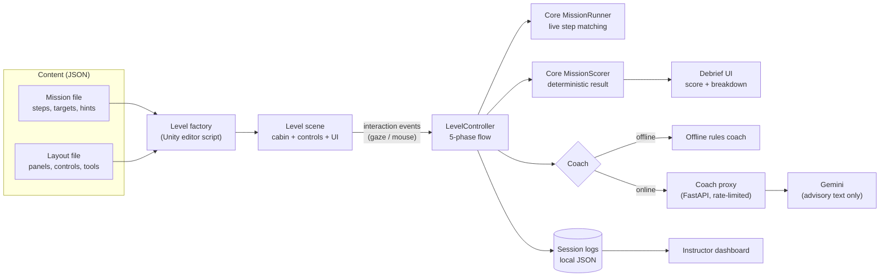

<!-- Banner: replace with the team lead's screenshot, e.g. media/banner.png (1280×400). -->
<!--  -->

# ASTRA Academy

**Astronaut-style procedure training on any Android phone and a ~₹1,000 Cardboard-style headset, or in a browser.**

[](https://dhruvsharma06-web.github.io/nasa-space-apps/)
[-2ea44f?style=for-the-badge)](https://github.com/dhruvsharma06-web/nasa-space-apps/releases/latest)
[](https://github.com/dhruvsharma06-web/nasa-space-apps/actions/workflows/ci.yml)

> **Fictional training prototype.** The ASTRA Station and every procedure are fictional. This is not
> astronaut certification or a real flight procedure. **Not affiliated with or endorsed by NASA.**
> The AI coach is advisory only. See [Safety & honesty](#safety--honesty).

---

## The problem → our solution

**Problem.** Learning a spacecraft procedure (do the right steps, in the right order, without touching
the wrong control) normally takes simulators or headsets that cost lakhs of rupees, so schools,
outreach programmes and remote learners almost never get hands-on practice. Most space learning
apps are passive: you watch and read, but nobody checks whether you could actually do it. And when an
app does grade you, it rarely explains *why* you passed or failed.

**Solution.** ASTRA Academy puts a trainee in a fictional space-station cabin on a phone in a cheap
headset (or in a browser), where they complete real-feeling procedures by looking and tapping. Every
level follows the same loop crews train with (brief → demonstrate → practise → qualify → debrief),
and a deterministic scorer explains exactly what went wrong ("you selected Bus A before Bus B").
New procedures are just two JSON files, so instructors could add training without touching Unity.

## Features

**Five phases in every level**
1. **Briefing**: the mission goal.
2. **Demonstration**: the controls light up in order.
3. **Practice**: the next control glows; hints appear after mistakes; ask the coach about the current step.
4. **Qualification**: scored, with no help.
5. **Debrief**: score, what went wrong, and how to improve.

**Nine levels**

| Level | Name | Skill taught | ~Time* | Status (browser build) |
|---|---|---|---|---|
| L0 | Safety & Calibration | Seat posture, recenter, pause/exit | 2 min | in progress |
| L1 | Cadet Orientation | Look, aim and select; finding panels | 3 min | in progress |
| L2 | Equipment Handling | Stow and secure tools | 4 min | ✅ playable |
| L3 | Cabin Familiarization | Configure the crew cabin | 4 min | ✅ playable |
| L4 | Emergency Response | Clear a power-bus fault | 4 min | in progress |
| L5 | EVA Preparation | Tether and tool check | 5 min | ✅ playable |
| L6 | Robotics | Capture a free-floating cargo module | 4 min | ✅ playable |
| L7 | Restore Station Power | Integrated final mission | 5 min | in progress |
| L8 | Launch Day | Fly from the launch pad to orbit, with a cabin fire to put out on the way (the cinematic finale; graduation follows) | 4 min | ✅ playable (2026-11-15: Editor PlayMode tests) |

<sub>*Estimated, to be replaced with timings measured in QA. Status as of 2026-11-14; see [docs/STATUS.md](docs/STATUS.md).</sub>

**Fair, explainable scoring**: 0–100 with Gold / Silver / Bronze ([docs/SCORING.md](docs/SCORING.md)).
The score comes only from what you did: critical steps completed, order, wrong controls, time. The same
attempt always gets the same score.

**AI flight instructor (advisory only)**: the debrief adds coaching advice, and in Practice you can ask
about the current step. Answers are grounded in the mission file and rate-limited, and they **never
change the score**. With no network, an offline rule-based coach gives the advice instead.

**Instructor dashboard**: every attempt writes a local session log (events + result). The dashboard
reads these logs and shows where trainees struggle. *(In progress.)*

**Phone VR for ~₹1,000**: an Android phone in a Cardboard-style headset, with 3DoF head tracking and gaze + tap.
Seated, with no artificial movement. *(In progress: not yet tested on a phone.)*

## How to play

**Browser (desktop Chrome or Edge recommended)**

| Action | Control |
|---|---|
| Look around | Click inside the cabin, then move the mouse (`Esc` frees the cursor) |
| Use a control | Aim the crosshair at it and **left-click** |
| Skip to Practice / Retry after the debrief | `Enter` |
| Skip the current phase card | `Space` |
| Pause / resume | `P` |
| Recenter the view | `R` |
| Restart the level | `Backspace` |
| Switch level | number keys `0`–`7` |

**Phone headset**: look at a control so the reticle sits on it, then **tap** (screen or headset button).
Recenter is always available. *(Final controls are confirmed once the phone build is tested.)*

## Architecture



- **One contract** ([CONTRACT.md](CONTRACT.md)) defines every boundary: events, mission files, runner, scorer, progress, coach API.
- The **Core** scoring code is plain C# with no engine references, and is also mirrored in JavaScript (`tools/level-sim`) and cross-checked against shared fixtures.
- The **coach key never reaches the client**: only the proxy holds it.

## Tech stack

Unity 6.3 LTS (6000.3.28f1) · Universal Render Pipeline · Input System · XR Interaction Toolkit ·
Google Cardboard XR Plugin · FastAPI (Python) · Gemini (advisory coach, via the proxy) · GitHub Actions · GitHub Pages

## Run it yourself

Requirements: **Unity 6000.3.28f1** (with Web and Android build support), **Git LFS**, Python 3.12+, Node 20+.

```bash
git lfs install
git clone https://github.com/dhruvsharma06-web/nasa-space-apps.git
cd nasa-space-apps
python scripts/validate_content.py            # must print OK
node tools/level-sim/test_scoring.mjs         # all tests pass
```

Unity tests (close the editor first). Windows PowerShell:
```powershell
& "C:\Program Files\Unity\Hub\Editor\6000.3.28f1\Editor\Unity.exe" -batchmode -projectPath . -runTests -testPlatform EditMode -testResults em.xml -logFile em.log
& "C:\Program Files\Unity\Hub\Editor\6000.3.28f1\Editor\Unity.exe" -batchmode -projectPath . -runTests -testPlatform PlayMode -testResults pm.xml -logFile pm.log
```

Build the level scenes and screenshots:
```powershell
& "C:\Program Files\Unity\Hub\Editor\6000.3.28f1\Editor\Unity.exe" -batchmode -projectPath . -executeMethod Astra.App.EditorTools.AstraSceneBuilder.BuildLevelsBatch -logFile b.log
& "C:\Program Files\Unity\Hub\Editor\6000.3.28f1\Editor\Unity.exe" -batchmode -projectPath . -executeMethod Astra.App.EditorTools.AstraShotCapture.CaptureBatch -shotsDir Builds/Shots -logFile s.log
```
In the editor, the same actions are in the **ASTRA** menu (*Build all level scenes from layouts*, *Build WebGL test build*, *Capture level screenshots*).

Coach proxy (optional; mock mode needs no key). See [services/coach-proxy/README.md](services/coach-proxy/README.md):
```bash
cd services/coach-proxy
python -m venv .venv && .venv/bin/pip install -r requirements.txt   # Windows: .venv\Scripts\python.exe -m pip ...
.venv/bin/python -m pytest -q
.venv/bin/uvicorn app.main:app --port 8787
```
Hosting the proxy: [services/coach-proxy/deploy/README.md](services/coach-proxy/deploy/README.md).
Publishing the browser build: `scripts/publish_web.sh` / `scripts/publish_web.ps1`.

**Add a level**: write `Assets/ASTRA/Content/Missions/l<N>-<name>-v1.json` and
`Assets/ASTRA/Content/Layouts/l<N>-layout.json`, run the validator, then *ASTRA → Build all level scenes from layouts*.

## Safety & honesty

- **Fictional.** The ASTRA Station and all procedures are invented for training practice. No real
  flight procedures, no export-controlled data, no agency logos.
- **Not affiliated with or endorsed by NASA** or any space agency.
- **The AI is advisory only.** It never changes a score or the simulation state, the app works fully
  offline, and the proxy is rate-limited. It only receives the scored result and event trace
  (debrief) or the trainee's question about the current step (Ask, with a consent notice first).
- **Privacy.** No accounts, names or camera/voice data. Session logs stay on the device.
- **Comfort.** Seated play, the camera never moves by itself, no fast flashing, and pause/recenter are always available.
- **What was tested where** (from [docs/STATUS.md](docs/STATUS.md), 2026-11-14):

  | Where | What | Result |
  |---|---|---|
  | Unity editor (batch mode) | EditMode + PlayMode tests (incl. a first-time-user playthrough of every level) | 231/231 and 55/55 passed |
  | Desktop Chrome (WebGL) | L2, L3, L5, L6, Briefing → Debrief | playable |
  | Android phone in headset | — | **not tested yet** |

## Credits, team and licence

- Every asset, dataset, library and service: **[CREDITS.md](CREDITS.md)**.
- Submission checklist and judging notes: [docs/SUBMISSION.md](docs/SUBMISSION.md). QA: [docs/QA.md](docs/QA.md).
- Contributor docs: [CONTRACT.md](CONTRACT.md) · [docs/PRD.md](docs/PRD.md) · [docs/TEAM.md](docs/TEAM.md) · [CONTRIBUTING.md](CONTRIBUTING.md)

| Team member | Role |
|---|---|
| _(name)_ | XR & Interaction: phone rig, UI, Hub, L0/L1 |
| _(name)_ | Core logic: runner, scorer, progress, L4/L7, dashboard |
| _(name)_ | Team lead: level factory, AI coach, L2/L3, builds |
| _(name)_ | Ship & QA: CI, web link, docs, L5/L6 |

Built for the [2026 NASA Space Apps Challenge](https://www.spaceappschallenge.org/2026/).
